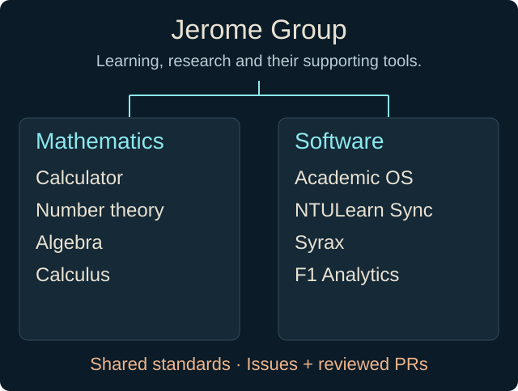

# Jerome Group

Mathematics, software and the systems that support learning and research.
A deliberately run collection of projects, with shared conventions and reviewed changes.

[Website](https://jeromegroup.org) · [Contributing](https://github.com/Jerome-Group/.github/blob/main/CONTRIBUTING.md) · [Security](https://github.com/Jerome-Group/.github/blob/main/SECURITY.md) · [Support](https://github.com/Jerome-Group/.github/blob/main/SUPPORT.md)

## Public work

All contributors to current public Jerome-Group repositories, including bots.
Linked resolutions count distinct currently closed public org issues linked to merged public org PRs, closed at or after the merge. This measures linkage, not who clicked Close.

[Numbers, included repositories and last successful refresh](https://github.com/Jerome-Group/.github/tree/prototype/profile-refresh-20261031/prototype-data) · [Daily refresh workflow](https://github.com/Jerome-Group/.github/actions/workflows/profile.yml).
Failed refreshes retain the previous data and timestamp. GitHub can delay scheduled runs.

A year of public activity and two recent events

The calendar counts issue openings, PR openings, PR merges and linked resolutions. It does not count commits, reviews or comments.

## Mathematics

- [Calculator](https://calculator.jeromegroup.org). Symbolic computation, notebooks and plots. The site requires sign-in. [Source](https://github.com/Jerome-Group/calculator).
- [Number theory](https://numbertheory.jeromegroup.org). An interactive atlas of elementary number theory. [Source](https://github.com/Jerome-Group/numbertheory).
- [Algebra](https://algebra.jeromegroup.org). Groups, rings, fields and representations, with visual explanations and interactive explorations. [Source](https://github.com/Jerome-Group/algebra).
- [Calculus](https://calculus.jeromegroup.org). Limits, derivatives, multivariable and vector calculus, with interactive graphs and 3D explorations. [Source](https://github.com/Jerome-Group/calculus).

## Software

- [Academic OS](https://github.com/Jerome-Group/academic-os). Module and research folders, tasks, calendars and data behind an academic dashboard.
- [NTULearn Sync](https://github.com/Jerome-Group/ntulearn). Course pages, announcements and attachments imported into local module folders.
- [Syrax](https://github.com/Jerome-Group/syrax). A personal chatbot system built around open-source agent tooling, with setup and runtime configuration.
- [F1 Analytics](https://github.com/Jerome-Group/f1-analytics). A live Formula 1 session dashboard, fed by a self-hosted OpenF1 instance.

## How we work

Start with an issue. Make focused pull requests, pass required checks and resolve review comments before merging. Disclose AI assistance in authored commits and PRs. Keep credentials and private data out of repositories.

[.github](https://github.com/Jerome-Group/.github) holds our shared contribution guidelines and community policies.
[Code of Conduct](https://github.com/Jerome-Group/.github/blob/main/CODE_OF_CONDUCT.md) · [Governance](https://github.com/Jerome-Group/.github/blob/main/GOVERNANCE.md).
Report vulnerabilities privately to security@jeromegroup.org.

Declared assistance in merged public PRs

PR counts, not effort or code volume. OpenAI model names do not identify which app was used.
[Classification and denominator](https://github.com/Jerome-Group/.github/tree/prototype/profile-refresh-20261031/prototype-data#declared-assistance).

How the profile refreshes

A bounded safety model of the existing publication workflow. It assumes complete generation and an atomic successful Git push. It does not prove source accuracy, concurrent-writer ordering, availability or live GitHub behavior.
[Model and limits](lifecycle.md).

